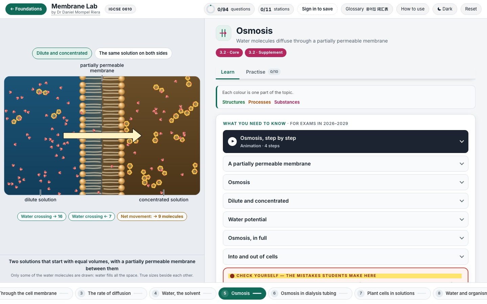

<div align="center">

<h1>🫧 &nbsp;Membrane Lab</h1>

**Cambridge IGCSE Biology 0610 · Topic 3, Movement into and out of cells**

[](https://nlcsbiology.com/membrane-lab/)


by **Dr Daniel Mompel Riera**

</div>



---

## What a student does

Each station has its own moving picture on the left and short cards on the right that open one at a time. Press a button
on the picture and it changes; open a card and the picture shows that part. Then the questions say right or wrong, never
the answer.

|  |  |
|---|---|
| 🧭 **11 stations** | diffusion · through the cell membrane · the rate of diffusion · water, the solvent · osmosis · osmosis in dialysis tubing · plant cells in solutions · water and organisms · active transport · root hairs and ions · the three compared |
| ✍️ **94 questions** | fill the gaps · multiple choice · put in order · match up · sort into groups · tick a grid · drag the words · press the part on a photograph |
| ⚛️ **Particles that keep moving** | every particle moves at random, for ever, in both directions. A net movement is what is left when the crossings each way are counted, and the counters show it |
| 🎬 **Step by step** | diffusion, from a whole cell down to its membrane, osmosis, a plant cell gaining and losing water, and a protein carrier using energy from respiration |
| ⚖️ **One factor at a time** | two boxes that differ in temperature, concentration gradient, surface area or distance: watch which one moves more particles across |
| 🧅 **Real cells** | photographs of red onion cells in a dilute and in a concentrated solution, with the vacuole, cell wall and cell membrane named on them |
| 📖 **A shared glossary** | one wording per term, the same in every lab; press 한국어, 中文 or 日本語 to see each word's name in Korean, Chinese or Japanese, and 🔊 to hear the hard words |

> [!NOTE]
> **The right answers are stored only as scrambled fingerprints.** The lab can tell a student they are wrong, but its
> questions cannot show what *right* is. The explanations of the multiple-choice options are published with the lab,
> scrambled, for the pupils whose teacher gives them the Accommodation: each sees an explanation after a second wrong try.
> Someone who unscrambles them could learn an answer.

## Where it sits

Behind the [Foundations](https://nlcsbiology.com/foundations-hub/) shelf (Topic 3), one shelf of the
[Biology Hub](https://nlcsbiology.com/biology-hub/) — the front door to every Biology app here. The **← Foundations**
button goes back up. Plant cells and root hair cells are also in the [Cells Lab](https://nlcsbiology.com/cells-lab/) and
the [Plants Lab](https://nlcsbiology.com/plants-lab/).

<details>
<summary><b>Behind the scenes</b> — how this lab works, in plain English</summary>

<br>

**Pictures that tell the truth.** The particles are not told where to go. Each one moves at random, and a wall, a
divider or a membrane lets it cross or not; the numbers on the screen are real counts of the crossings each way. Molecules
and membranes are drawn at their true sizes beside each other wherever the picture says so, and the motion is slowed down
many millions of times. The photographs are real micrographs, credited under the picture.

**Why the right answers are not in the page.** Each question carries a *scrambled fingerprint* of its answer. When a
student answers, the page scrambles what they did in the same way and compares the two. Scrambling only works one way, so
no fingerprint can say what the right answer is — only *not that one*. The real answers live in one file that is never
published.

**The answers for teachers.** `js/data/answers.lock.json` holds this lab's answers and explanations, **locked** (AES-256
encryption). The lab's pages never load it. Only the Biology Hub's teacher page opens it, when a teacher presses **Show the
answers** on Homework analysis, with a key kept in the labs script's settings and on the author's computer, never in this
repository. Without that key the file cannot be read. How it works, and what it means for a school running its own copy:
the Biology Hub's README, *Teacher mode, and the teacher page*.

**What is shared with the other labs.** The question engine, the marking, the saving, the sign-in, the widgets and the
glossary are kept in one place and copied in whenever a lab is rebuilt, so a fix reaches every lab at once. What belongs
to this lab alone is its content and its pictures.

**Rebuilding it** (only needed if you change the content). One command reads the master file with the answers in it and
writes out the published version with only the fingerprints. It refuses to finish unless every answer still marks
correctly. The `tools/` named here stay on Daniel's computer: they are not in this repository.

```
node tools/build.mjs
```

Picture credits: [`assets/photos/CREDITS.md`](assets/photos/CREDITS.md).

Pronunciation: the 🔊 UK and 🔊 US buttons beside the hard words play the Cambridge Dictionary's own recordings from its website (© Cambridge University Press & Assessment; nothing of theirs is stored here), with Wikimedia Commons recordings as the backup.

</details>

Made by **Dr Daniel Mompel Riera** ·
[dmompelriera@nlcsjeju.kr](mailto:dmompelriera@nlcsjeju.kr)

## Licence

| What | Licence |
|---|---|
| **The software** — everything that runs: JavaScript, HTML structure, CSS, build tools | [AGPL-3.0](LICENSE) |
| **The teaching material** — question text, explanations, diagrams and images I made, wherever they are stored | [CC BY-NC-SA 4.0](LICENSE-CONTENT) |

**In plain English.** Use it, change it, run it for your students — free, and you never need to ask. If you change the
software and let anyone else use it, *including over a network*, you have to publish your source under the same licence.
You may not sell the teaching material or use it commercially, and the credit has to stay.

**Not covered:** third-party images and media keep their own licences — see the picture credits.

© 2026 Dr Daniel Mompel Riera. I hold the copyright, so I can grant other terms: if you want to use any of this
commercially, ask me at <dmompelriera@nlcsjeju.kr>.
